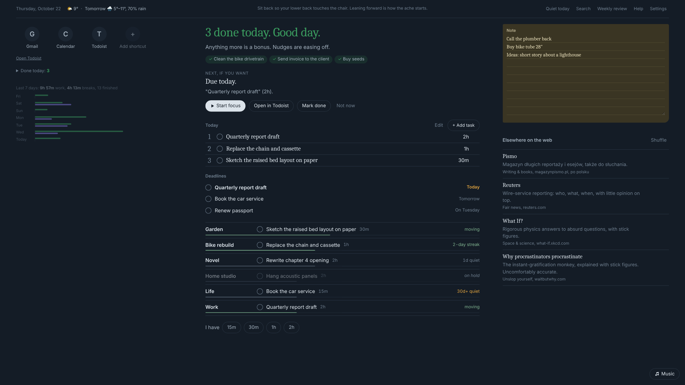
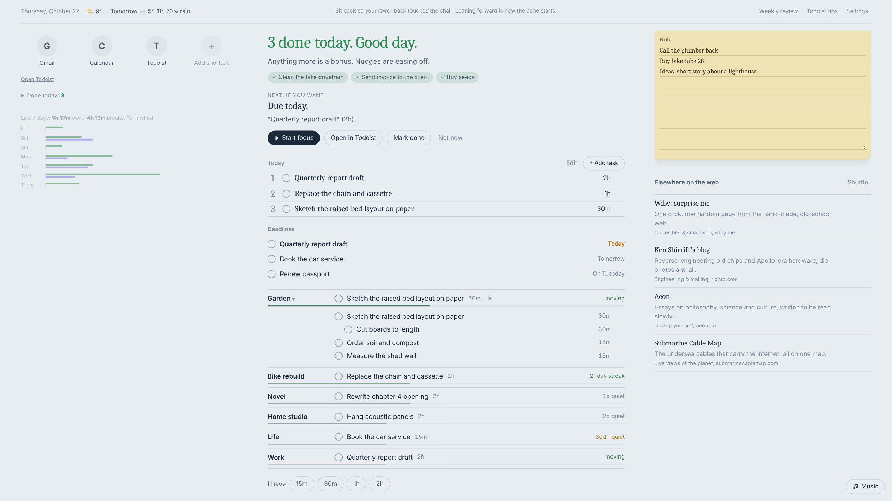
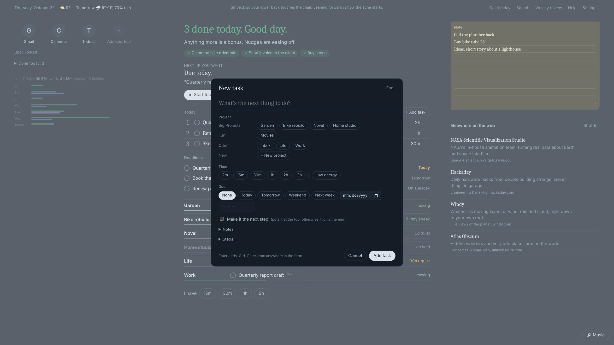
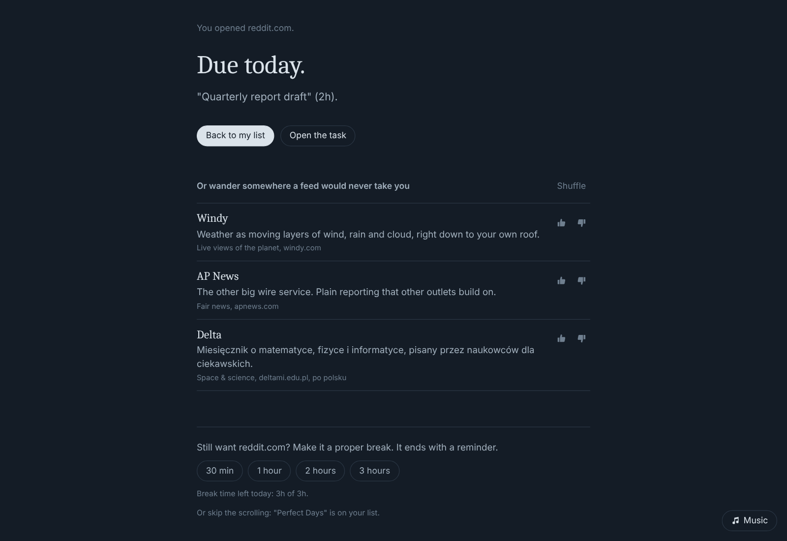
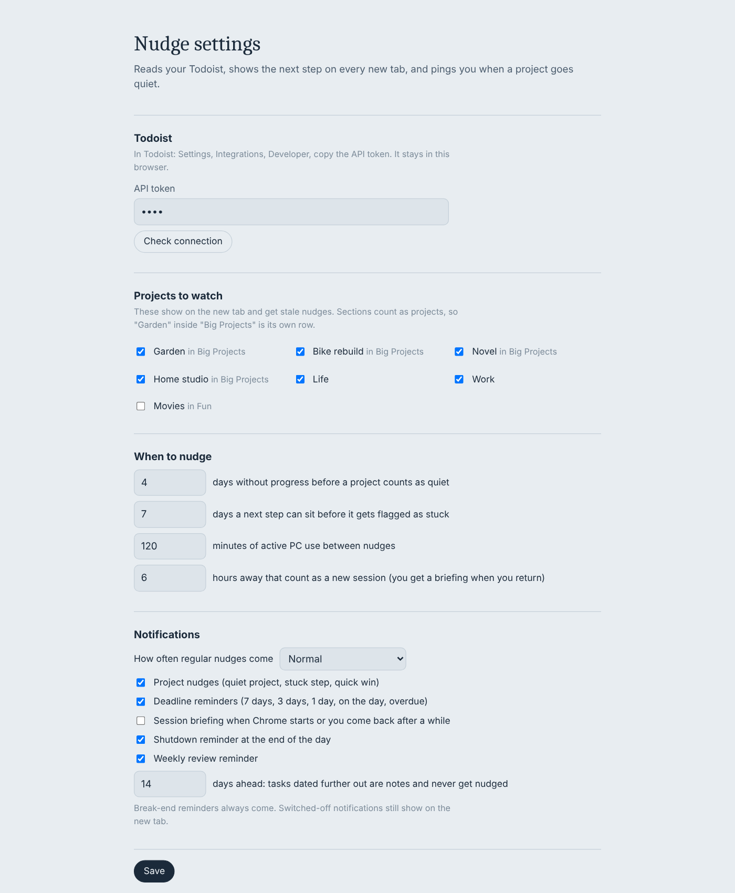
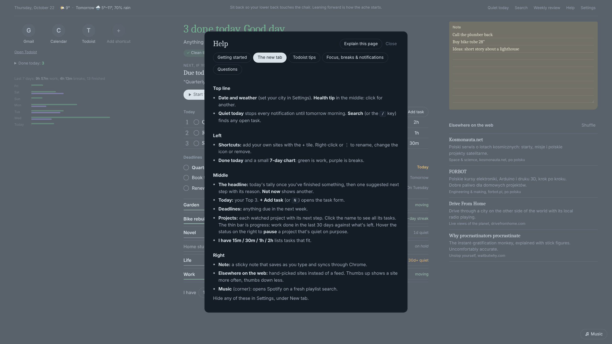

# Nudge

I kept starting projects and then losing them: to the feed, to the backlog, to forgetting they existed. So I made the first thing my browser shows me a calm reminder of what I actually want to be doing, instead of what an algorithm wants me to watch.

Nudge replaces Chrome's new tab page. It uses Todoist only as the place your tasks are stored; you don't need to live in the Todoist app.

Every new tab shows what you've done today, one next step with the reason for it, your deadlines and every project's next task. When a project goes quiet you get a gentle notification that says why. Reddit and Facebook open a pause screen first: your next step, a few hand-picked corners of the web, or a timed break.

It's a free, open-source extension you load yourself (it isn't on the Chrome Web Store). There is no account, server or tracking. It talks only to Todoist, Open-Meteo for the weather if you set a place, and Claude if you add an API key.



**At a glance:** praise for what you finished · one next step with a reason · Top 3 for the day · deadlines · every project's next task and progress · focus timer · pause screen for reddit and Facebook with timed breaks · hand-picked sites instead of feeds · calm, switchable notifications · Help with an "explain this page" mode.

## Setup (about 5 minutes)

You need **Chrome** (or another Chromium browser) and a **Todoist** account. The free plan is enough.

1. Download this repo. Click **Code**, then **Download ZIP**, and unzip it somewhere permanent, such as `Documents/nudge`. Chrome loads the extension from that folder, so don't delete it.
2. Open `chrome://extensions`, switch on **Developer mode** (top right), click **Load unpacked** and choose the folder that contains `manifest.json`.
3. Chrome asks whether to keep the new tab change. Choose **Keep it**.
4. The settings page opens. In Todoist, go to **Settings**, then **Integrations**, then **Developer**, and copy your **API token**. Paste it into the settings page and click **Check connection**.
5. Tick the projects you want watched, optionally search for your city under **Weather**, and click **Save**.
6. To make Chrome start on it, go to `chrome://settings/onStartup` and choose **Open the New Tab page**.
7. Chrome adds a coloured footer to extension new tab pages. Right-click it and choose **Hide footer on New Tab page**.
8. On Windows, check that notifications from Google Chrome are allowed (**Settings**, **System**, **Notifications**).

**Updating:** download the new version, unzip it over the same folder, then click the reload arrow on Nudge's card in `chrome://extensions`. If you forget, the new tab shows a **Reload Nudge** button. Your settings, shortcuts and note stay.

**Stuck?** Press `?` on the new tab for Help, or see the Questions tab there.

## How it reads your Todoist

- **A section counts as a project.** "Garden" inside "Big Projects" gets its own row. A project without sections is a single row. The Todoist free plan allows 5 projects, so sections are how you get more.
- **The top task is the next step.** Drag the real next step to the top of each section in Todoist.
- **Quiet means nothing completed** in that project for 4 days (you can change this). Adding tasks doesn't count as progress.
- **Labels add detail:**
  - `15m`, `30m`, `1h`, `2h` (any number with m or h): time estimates
  - `2m`: a two-minute task
  - `low`: a low-energy task
  - `soft`: the due date is a plan, not a deadline
- **Leisure projects never get nudged.** These are projects or sections named Fun, Movies, Games, Books or Watch. They show up as evening suggestions instead.
- **Far-off tasks are notes.** A task dated more than 14 days ahead is never nudged until it gets closer.

The **Help** button on the new tab (or the `?` key) has a getting-started guide, Todoist tips and answers to common questions. Its **Explain this page** mode lets you hover over any part of the new tab to see what it does.

## Features

### The new tab



- **Today's tally comes first.** Once you've finished something, the headline is praise, with what you did shown as ✓ chips. The next step drops below it, smaller.
- **One nudge, with a reason.** For example: an overdue deadline, a project quiet for 6 days, a next step that has sat for a week, momentum worth keeping, a quick win, or a random forgotten task. **Not now** shows another one.
- **Top 3:** pick up to three tasks for the day. They lead the nudges. A day runs from 04:00 to 04:00, so late nights count as the same day.
- **Deadlines:** due dates in the next week, with overdue ones in amber.
- **Projects:** every watched project with its next step, a streak or quiet label, and a thin progress bar: finished work (last 30 days) against what's still open, by estimate (30m for unlabeled tasks). It turns green when everything is done. Click a project's name to see all its tasks. Hover the status on the right and click **Pause** for a project that's quiet on purpose: it's dimmed, shows "on hold" and gets no nudges until you resume it.
- **I have 15m / 30m / 1h / 2h** lists the tasks whose estimates fit.
- **Add task** (or the **N** key) opens a form with buttons for project, estimate, energy, due date, notes and subtasks. It writes the right Todoist labels for you, and **+ New project** creates a section.



- **Focus timer:** the ▶ next to any task starts it, and nudges pause while it runs.
  - **Done** completes the task.
  - **Stop** saves what you got done as a completed subtask.
  - Tasks you finish without the timer count their estimate, or 30m if they have no time label.
- **Left column:**
  - shortcut tiles: add, rename, or change an icon via ⋮ or right-click. The icon can be the site's own, a letter or an emoji.
  - Done today
  - a small 7-day chart of work and break time
- **Right column:**
  - a sticky note that syncs through your Chrome account
  - **Elsewhere on the web**: hand-picked sites, see below
- **Top line:** the date, the weather for now and tomorrow if you set a place, and a health tip that changes hourly. Click the tip for another. Tips cover the body, the mind, family and friends, and a few lines from wiser people.
- **Music:** the corner button opens Spotify's web player on a fresh playlist search. The choices are Focus, Energy, Calm, or Surprise me (a random genre).

### The pause screen



These pages open a pause screen first:
- the Reddit front page and subreddits
- Facebook
- anything else you add in Settings

Single Reddit posts, say from a web search, open normally.

The pause screen shows your next step, three hand-picked sites and a leisure suggestion from your Fun list. You can also start a **30m / 1h / 2h / 3h break**, which lets the sites through until a reminder says it's over. Breaks have a daily budget, 3 hours by default; after that only 15-minute breaks are offered.

### Hand-picked sites

There are about 90 sites outside the algorithm, in eight groups:
- engineering and making
- space and science
- live views of the planet (Flightradar24, WindowSwap, ships, lightning)
- fair news (wire services, fact-checkers, left/right pairs)
- "unslop yourself" (small web, clear thinking)
- books
- curiosities
- music found by humans

16 of them are Polish, because that's where the author lives. Delete them or add your own in `golden.js`.

Thumbs up makes a site up to 4× as likely to appear. Thumbs down makes it rare, and two thumbs down hide it; you can bring hidden sites back in Settings.

### Notifications

- **Project nudges:** at most one per 2.5 hours of active PC use, with idle time and breaks not counted. After 3 tasks done in a day they come half as often, and after 5 they stop for the day.
- **Deadline reminders:** 7 days before, 3 days, 1 day, on the day, then daily while overdue.
- **Shutdown** (00:00 by default): an orange card with the day's summary and tomorrow's Top 3, then quiet until morning.
- **Weekly review** (Sunday 21:00 by default): the week's numbers, empty the Inbox, check each project's next step, clear stuck steps, and pick Monday's Top 3. It also has a button on the top bar.
- **Session briefing** when Chrome starts. It's off by default.
- **Nothing pops up in the first 10 minutes** after Chrome starts, and several deadline reminders at once arrive as one notification.
- **Quiet today** (top bar) stops every notification until tomorrow morning, deadlines included. It asks first, and lists anything still due today.

Under Notifications in Settings, **Quiet / Normal / Chatty** sets how often nudges come, and each kind has its own switch.

### Optional: Claude wording

Add an Anthropic API key in Settings and nudges are worded by Claude Haiku from your Todoist data. API use is billed separately from a Claude subscription and costs a small fraction of a cent per nudge. Without a key, the built-in lines in `voice.js` are used. They mix witty, coach-like and deadpan, and you can add your own.

### Search

**Search** on the top bar (or the `/` key) finds any open task by name across all projects. Tick it, start a timer or open it in Todoist from the results.

### Make it yours

In Settings:
- **New tab:** show or hide the praise headline, weather, health tip, note, hand-picked sites, music button, 7-day chart, Done today, "I have…" and the shutdown card. Choose how many hand-picked sites to show (2 to 8).
- **Your day:** break budget, shutdown and weekly review times, and when a new day starts (04:00 by default).
- **Backup:** export your settings, shortcuts, note, weather place and site ratings to a file, and import them on another PC. Your Todoist token and API key are never included.

Up to 40 shortcut tiles fit on the left; the column scrolls if they don't all fit.



### Help

The **Help** button (or `?`) has Getting started, The new tab, Todoist tips, Focus/breaks/notifications and Questions. **Explain this page** outlines whatever you hover over and says what it does.



## Privacy

- **Your Todoist token** is stored in this browser's local extension storage.
- **Your note, Top 3, shortcuts and weather place** sync through your own Chrome account.
- **Nothing is sent anywhere except:**
  - the Todoist API
  - Open-Meteo, only if you set a weather place
  - Google's favicon service, for shortcut icons
  - Anthropic's API, only if you add a key

## Customising it, or checking the code

Everything is plain JavaScript with no build step and no dependencies: edit a file, reload the extension, done. Text lives in `voice.js` (nudges), `wellness.js` (tips) and `golden.js` (sites), so those are the easiest places to start.

If you'd like an AI coding agent (Claude Code or similar) to change it for you or review it, point it at [HANDOFF.md](HANDOFF.md) first. It explains how the parts fit together, the conventions, the known limitations and what to check before you trust a change.

## Files

| File | What it does |
| --- | --- |
| `engine.js` | Decision logic: staleness, deadlines, nudge choice, briefing. Pure functions. |
| `voice.js` | Every line of nudge text. |
| `golden.js`, `goldenui.js` | The hand-picked sites and their list with thumbs. |
| `background.js` | Timers, notifications, pause redirect, Todoist sync. |
| `todoist.js`, `taskform.js`, `addtask.js` | Todoist API client and the add-task form. |
| `daily.js`, `tracking.js` | Top 3, streaks, break budget, shutdown, review; focus and break maths. |
| `today.js`, `review.js`, `help.js` | The Top 3 picker, the weekly review and the Help window with explain mode. |
| `shortcuts.js`, `postit.js`, `weather.js`, `wellness.js`, `music.js`, `corner.js` | Tiles, note, weather, health tips, music button. |
| `newtab.*`, `pause.*`, `options.*` | The three pages. |

Tests (Node 20+):

```
node --test test/engine.test.mjs test/golden.test.mjs test/taskform.test.mjs test/tracking.test.mjs test/daily.test.mjs
node test/background.harness.mjs
```

Issues and pull requests are welcome. Ideas that make it calmer are more likely to be merged than ones that make it louder.

## Licence

MIT. See [LICENSE](LICENSE).
